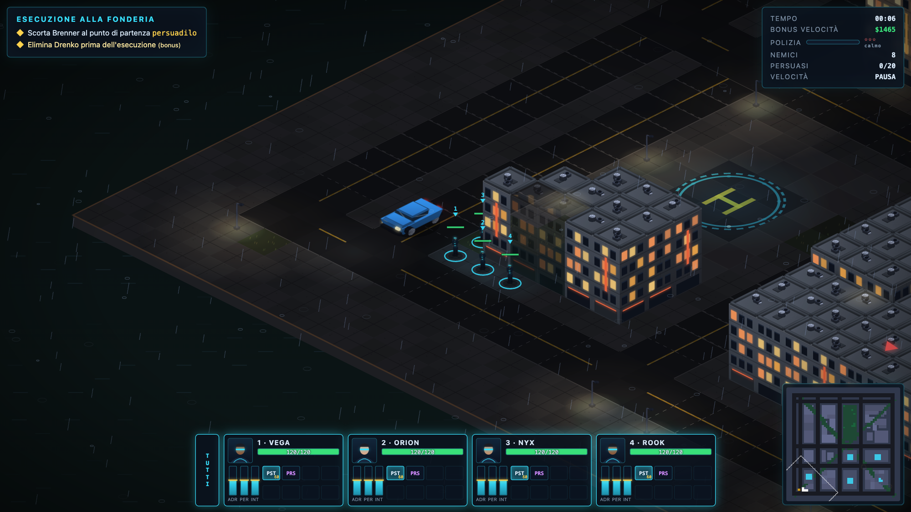
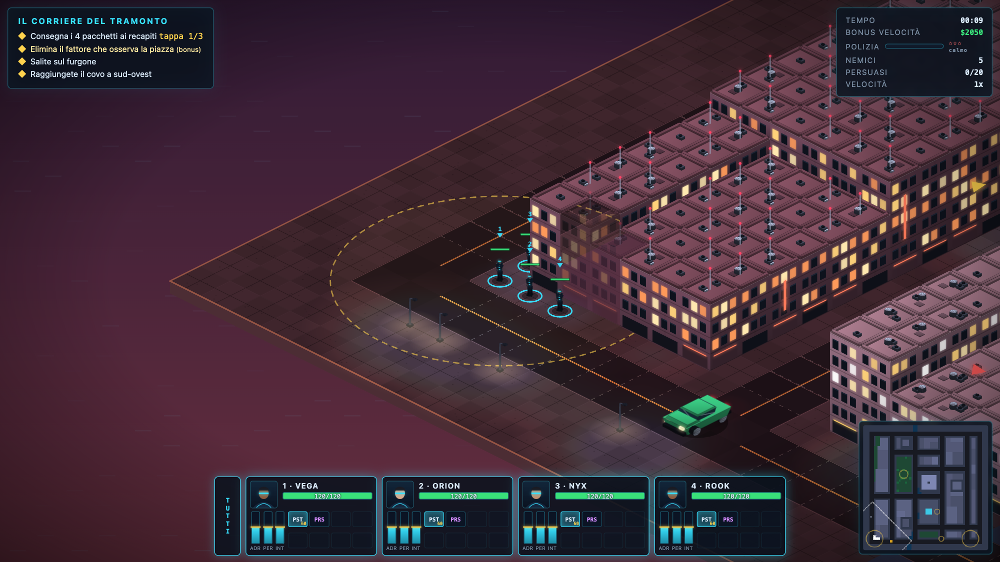

# Consortium Zero

Gioco tattico isometrico in sola tecnologia web, ispirato a *Syndicate* di Bullfrog (HTML5 Canvas 2D + ES modules + WebAudio). Nessuna dipendenza, nessuna build, nessun asset esterno: grafica e audio sono procedurali e originali (nessun materiale di Bullfrog/EA/FreeSynd).
Lavori automatici (agenzie AI): iniziare da `AGENTS.md`; creazione missioni: `docs/MISSIONI_AI.md`.

## Screenshot
|Fonderie di Voltri (tema industriale, pioggia)|Porto Franco (tema tramonto)|
|---|---|
|||

## Avvio
- Locale: `python3 serve.py` → http://localhost:8080
- Aruba (PHP): carica la cartella così com'è; `missions.php` elenca le missioni. Senza PHP: `python3 tools/build_index.py` genera `missions/index.json` (fallback statico).

## Gioco
4 agenti cyborg, Persuadertron (capacità limitata, cresce con "Cervello"), barre droghe ADR/PER/INT, potenziamenti, armeria che si sblocca missione dopo missione, veicoli (V per salire, investono), traffico urbano realistico: corsie a senso unico che formano anelli intorno agli isolati, auto che vanno nel verso giusto, code agli incroci che defluiscono, pedoni che si scansano. Tessere accesso e cancelli, polizia con livello di allerta, morte permanente (reclutamento a pagamento). Salvataggio in localStorage.
Comandi: `F1` / `H` in gioco. Novità: `X` stop, `Z` rinfodera/estrai, `WASD` camera, ordini anche in pausa tattica (anteprima tratteggiata dei percorsi), doppio click su agente = centra, tasto `G` o `Ctrl/Cmd+A` o pulsante `TUTTI` sotto la barra delle squadre = seleziona tutta la squadra in un colpo, click destro sulla minimappa = muovi la squadra, tooltip sulle unità. Novità di questa revisione: ambiente audio meteo (pioggia/vento/ronzio città con dissolvenze, disattivato con "Effetti meteo"), passi sonori degli agenti, riga VELOCITÀ nel pannello cliccabile per cambiare 1x→1.5x→2x→3x→0.5x, bonus velocità live nel TEMPO, stelle polizia sincronizzate con gli effettivi rinforzi, relitti che si raffreddano e spariscono. Kit narrativo per gli script di missione (dialoghi a tempo, zone-trigger, talpe che cambiano fazione, coprifuoco, meteo dinamico, camera cut) + obiettivi a tappe (`via`) e `board` (salire su un veicolo): missione 07 "Il corriere del tramonto".

IA nemica: rilevamento graduale (indicatore `?`, più lento con armi rinfoderate), memoria condivisa, allarme tra alleati, ricerca in più punti e ritorno alla posizione, flanking, strafe, ripari prenotati (niente ammassamenti), soppressione da colpi vicini, raffiche, anticipo del bersaglio (livello 3), ritirata se in inferiorità, medikit, recupero di armi a terra, evitamento di bombe e missili. Precisione e danno scalano col livello `ai`.

Polizia: con calore 0 intima "GETTA L'ARMA!" a chi gira armato; se rinfoderi entro il timer ti lascia andare, altrimenti attacca. Il calore (stelle) sale con spari, vittime e aggressioni; oltre le soglie arrivano volanti di rinforzo (disattivabili con `"policeBackup": false`).

Compagni: gli agenti estraggono le armi da soli se la squadra è attaccata, gli agenti non selezionati senza ordini seguono il gruppo in formazione (si fermano se ingaggiati in combattimento o con ordini in corso), usano il medikit in emergenza, concentrano il fuoco. IPA come nell'originale: ADR = velocità e cadenza, PER = reattività e portata, INT = precisione e comportamenti sensati (fuoco in movimento, medikit, schivata esplosivi). I persuasi seguono il proprio agente in formazione, salgono sui suoi veicoli, raccolgono armi e lo assistono.

Grafica: illuminazione notturna dinamica (lampioni, neon, fari, sirene, spari, esplosioni), meteo per missione (pioggia con lampi, nebbia, sereno), mare e banchina ai bordi, eliporti, animazioni di caduta, torretta sui blindati, audio posizionale stereo. Luci e meteo si disattivano dalle Opzioni.

## Aggiungere una missione
Copia una cartella in `missions/` (es. `missions/06-nome/`) con un `mission.json` (e opzionalmente `mission.js`). Le cartelle che iniziano con `_` sono ignorate; `missions/_template` è il modello. Nessuna modifica al codice.

### mission.json (campi principali)
- `name`, `order`, `requires:[id missioni]`, `region:{name,x,y}` (x,y 0..1 sulla mappa), `difficulty` 1-5, `reward`, `parTime`, `timeLimit`, `unlocks:[armi]`, `briefing`, `traffic`, `policeHostile`, `maxCivilianCasualties`, `sequential`, `script`, `weather` (`clear|rain|fog`), `ambient` (colore CSS della luce ambiente notturna), `policeBackup` (false = niente rinforzi), `theme` (preset `citta|deserto|industriale|artico|tossico|tramonto` o oggetto con colori di edifici, strade, erba, mare; vedi `docs/MISSIONI_AI.md`).
- `map`: `{ "generate": {seed,w,h,layout,water,block,park,plaza,heightBias} }` oppure `{ "ascii": [...], "anchors": {nome:[x,y]} }`.
  - `generate.layout`: `grid` (griglia ortogonale, default) | `distretti` (isolati densi al centro, grandi blocchi in periferia, viali diagonali) | `radiale` (anelli concentrici + assi passanti) | `organico` (strade a T, tessuto medievale) | `auto` (scelta dal seed).
  - `generate.water`: `none` | `south` | `east` | `fiume` (meandro con ponti: le corsie lo attraversano) | `baia` (angolo di mare). In `auto` l'acqua compare a caso.
  - ASCII: `.` marciapiede `+` piazza `Z` pista `,` erba `~` acqua `T` albero `F` recinto `G` cancello (tessera) `1-9`/`#` edifici (altezza) `> < v ^` corsie a senso unico (le auto le percorrono solo in quella direzione; `X`/`=` incroci, svoltabili in ogni corsia coerente).
  - Ancore generate: `spawn plaza pad park center tower tower_door nw ne se sw`.
- `start`: posizione (vedi sotto). Posizioni: `[x,y]`, `{anchor,dx,dy}`, `{rect:[x0,y0,x1,y1]}`, `{random:"pave|plaza|grass|road",near,radius}`.
- `entities[]`: `kind` = `civilian|scientist|guard|police|enemy|vip|vehicle`; `id`, `count`, `at`+`spread` | `area` | `zone`, `weapons`, `hp`, `speed`, `ai` (1-3), `vision`, `patrol` (`"random"` o lista posizioni), `group`, `tags`, `persuadable`, `persuadeCost`. Veicoli: `type` (car|van|armored|police), `hostile`, `parked`, `route:[posizioni]` (pattuglia: il veicolo insegue i waypoint in ordine, avanzando solo a fine tratta).
- `pickups[]`: `{item, at, quest, id, label}`.
- `waves[]`: `{time | onAlarm | onHeat, entities, message, alert}`.
- `objectives[]`: `kill`, `persuade`, `eliminate` (faction/group), `reach` (at, radius, `via:[posizioni]` per consegne a tappe in ordine, `all:false` = basta un agente; scatta dopo gli altri obbligatori, `early:true` per esonerarlo), `retrieve` (item, deliver), `destroy`, `escort`, `board` (target=veicolo con id: completato quando un agente sale a bordo; mezzo distrutto = sconfitta), `survive`, `custom`. Opzionali: `optional`, `bonus`, `text`.

### mission.js (facoltativo)
`export default { init(ctx), update(ctx,dt), onKill(ctx,vittima,killer), onPersuade, onPickup, onObjective(ctx,obj) }` con `ctx.spawn`, `ctx.say`, `ctx.complete(id)`, `ctx.fail`, `ctx.win`, `ctx.addObjective`, `ctx.alarm`, `ctx.agents()`, `ctx.get(id)`, `ctx.setPath(unit,x,y)`, `ctx.damage(vittima,amt,fonte,tipo)`. Kit narrativo: `ctx.after(sec,fn)` / `ctx.every(sec,fn)` (scheduler), `ctx.dialog([[speaker,text,tone],...],gap)` (tostade a cascata), `ctx.trigger(pos,radius,fn)` (una sola volta all'ingresso in zona), `ctx.faction(u,0)` (defezione: alleato che segue la squadra), `ctx.give(u,arma,munizioni)`, `ctx.heal(u,n)`, `ctx.remove(u)` (scomparsa per dipartite scripted), `ctx.heat(n)`, `ctx.weather('clear|rain|fog')`, `ctx.lockdown(on)` (coprifuoco: polizia permanente, calore a 100), `ctx.focus(x,y)` (carrellata camera). Esempi: `missions/05-torre-nera/mission.js` (ondate al boss), `missions/06-esecuzione/mission.js` (carnefice che insegue l'ostaggio con `escort`+`kill`), `missions/07-corriere/mission.js` (vetrina completa del kit: talpa, coprifuoco, meteo, camera cut).

## Missioni casuali e agenti AI
`python3 tools/random_mission.py` crea una missione valida (tipo, tema, difficoltà casuali o scelti; `--after <cartella>` la lega a un checkpoint di campagna); `python3 tools/validate_mission.py` la controlla. Guida completa per agenti AI: `docs/MISSIONI_AI.md`. Punto d'ingresso standard per agenti di coding (regole, mappa del motore, riferimenti): `AGENTS.md`.

## Struttura
`js/` motore (render isometrico con cache sprite HiDPI, IA, combattimento, pathfinding A*, missioni, HUD, schermate) · `css/` · `missions/` · `serve.py` · `missions.php`.
